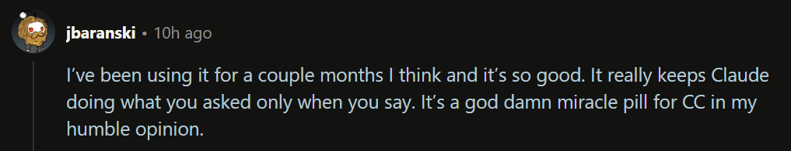
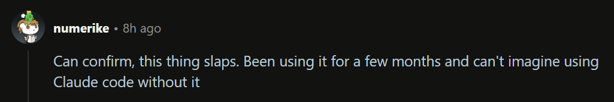

<p align="center"></p>
<div align="center">An opinionated approach to productive development with Claude Code</div>
<div align="center"><sub><em>Public good brought to you by GWUDCAP and Three AIrrows Capital</em></sub></div>
<br>
<br>
<div align="center">

[](https://www.npmjs.com/package/cc-sessions)
[](https://www.npmjs.com/package/cc-sessions)
[](https://pypi.org/project/cc-sessions/)
[](https://pepy.tech/project/cc-sessions)
</div>
<div align="center">

[](https://opensource.org/licenses/MIT)
[](https://x.com/AgentofToastX)
[](https://dexscreener.com/solana/oy5mbertfqdytu8atyonycvcvu62fpmz3nkqoztrflq)
[](https://github.com/hesreallyhim/awesome-claude-code)
</div>

<div align="center"></div>
<div align="center"></div>

<br>

## latest updates

<strong>latest release - v0.3.0</strong>
<br>
<em>it's basically autopilot</em>

**major highlights:**
- **Dual Language Support**: Now available as both Python and Node.js packages with complete feature parity
- **Unified Sessions API**: Single `sessions` command replaces multiple slash commands
- **Natural Language Protocols**: Full workflow automation through trigger phrases (mek:, start^:, finito, squish)
- **Todo Validation System**: Approved todo lists are locked and tracked to prevent scope creep
- **Directory Tasks**: Multi-phase projects with subtasks on shared feature branches
- **Kickstart Tutorial**: Interactive onboarding teaches cc-sessions by using it
- **CI Environment Detection**: Auto-bypass DAIC in GitHub Actions (thanks @oppianmatt)
- **Enhanced Statusline**: Nerd Fonts + git tracking with ahead/behind indicators (thanks @dnviti)
- **Safe Uninstaller**: Interactive removal with automatic backups (thanks @gabelul)

See [CHANGELOG.md](CHANGELOG.md) for complete details.

## installing the extension

You install cc-sessions into a repo from the project root:

```bash
cd ~/my-git-repo && [npx|pipx run] cc-sessions
```

There are Python and Node packages - use whichever you have:

### Python

```bash
# Navigate to the repo you want to 
# use cc-sessions in, then...
pipx run cc-sessions
```

### Node

```bash
# Navigate to the repo you want to 
# use cc-sessions in, then...
npx cc-sessions
```

<details>
<summary>

### what gets installed
</summary>

The installer sets up:
- Hook files in `sessions/hooks/` for DAIC enforcement
- API commands in `sessions/api/` for state/config management
- Protocol templates in `sessions/protocols/` for workflow automation
- Specialized agents in `.claude/agents/` for heavy operations
- Sessions API wrapper slash command in `.claude/commands`
- Initial state in `sessions/sessions-state.json`
- Configuration in `sessions/sessions-config.json`
- Automatic `.gitignore` entries for runtime files
</details>

### updates and uninstalls/reinstalls

The system automatically preserves your work:
- Creates timestamped backups in `.claude/.backup-YYYYMMDD-HHMMSS/`
- Preserves all task files and agent customizations
- Preserves sessions-config.json
- Restores everything after installation completes
- State file regenerates fresh

<br>

## kickstart: interactive tutorial

You can select whether to take the interactive tutorial at the end of the installer. Its pretty quick and it will fully onboard you if you're new, using cc-sessions to teach you cc-sessions.

The system teaches itself through index-based progression, then cleans up its own onboarding files on graduation.

<br>

## quick start

<details><summary><em>Best way to get started is kickstart, but...</em></summary>
<br>

**After installation (and, optionally, kickstart), use trigger phrases to control workflows:**

```
You: "mek: add user authentication"
Claude: [Creates task with interactive prompts]

You: "start^: @sessions/tasks/h-implement-user-auth.md"
Claude: [Loads context, proposes implementation plan with specific todos]

You: "yert"
Claude: [Implements only the approved todos]

You: "finito"
Claude: [Completes task: commits, merges, cleans up]
```

**These trigger phrases are the defaults.** Add any trigger phrases you like:

```bash
# See current triggers
/sessions config triggers list

# Add your own phrase to any category
/sessions config triggers add go lets do this

# Categories: go, no, create, start, complete, compact
# Slash command API syntax: /sessions [subsystem] [command] [arguments]
# Context-aware help on failed commands - fail away
```

Check `sessions/sessions-config.json` to see all configuration options.
</details>

<br>

## why I made cc-sessions

<details><summary><em>I made cc-sessions to solve what I don't like about AI pair programming...</em></summary>
<br>
If you ask Claude a question he may just start writing code, especially if you are in the middle of a task.

Without additional scaffolding, you are often manually adding files to context for 20% of the context window and being perennially terrified of having to compact context.

The list of things you have to remember can get quite large: 

  - compact before you run out of tokens 
  - read every diff before approving
  - write task files
  - commit changes
  - merge branches
  - push to remote
  - manage which tools Claude can use
  - remember to run the right slash commands 

The cognitive overhead balloons quickly.

Tasks don't survive restarts. Close Claude Code, reopen it, and you're explaining everything from scratch. No confidence that work will continue cleanly and no structure to how to handle working across context windows.

**You discover problems faster than you can solve them.** Without a standardized, friction-free way to capture tasks, these insights vanish.

When context does get compacted automatically, it doesn't preserve enough detail to inspire confidence. 

Most have a CLAUDE.md file stuffed with behavioral rules, some of which are simple where others are complex branching conditional logic. 

LLMs are terrible at following long instruction lists throughout an entire conversation. The guidance degrades as the conversation progresses.

Git workflow adds constant friction: creating branches, crafting commit messages, merging when complete, pushing to remote. More cognitive overhead.

**So, cc-sessions fixes all of this.**
</details>

<br>

## features summary

<details><summary><em>click to learn about features...</em></summary>
<br>

### Discussion-Alignment-Implementation-Check (DAIC)

Claude earns the right to write code. By default, Edit, Write, and MultiEdit tools are completely blocked. Before Claude can touch your codebase, he has to discuss his approach, explain his reasoning, and propose specific todos you explicitly approve with trigger phrases like "go ahead" or "make it so" (fully customizable).

Once you approve the plan, Claude loads those exact todos and can only work on what you agreed to. Try to change the plan mid-stream? The system detects it and throws him back to discussion mode. No scope creep. No surprise rewrites. Just the work you approved.

### Task Management That Survives Restarts

Tasks are markdown files with frontmatter that tracks status, branches, and success criteria. The system automatically creates matching git branches, enforces branch discipline (no committing to wrong branches or editing files off branch), and loads complete context when you restart a task days later.

Directory-based tasks support complex multi-phase work with subtask workflows. File-based tasks handle focused objectives. Task indexes let you filter by service area. Everything persists through session restarts.

### Specialized Agents for Heavy Lifting

Five specialized agents run in separate context windows to handle operations that would otherwise burn your main thread:

- **context-gathering** - Analyzes your codebase and creates comprehensive context manifests for each task you create
- **logging** - Consolidates work logs chronologically
- **code-review** - Reviews implementations for quality and patterns
- **context-refinement** - Updates task context based on session discoveries
- **service-documentation** - Maintains CLAUDE.md files for services

Each agent receives the full conversation transcript and returns structured results to your main session.

### Protocols That Automate Workflows

Pre-built protocol templates guide task creation, startup, completion, and context compaction. They adapt automatically based on your configuration—no manual decisions about submodules, commit styles, or git workflows. The protocols just know what you prefer and act accordingly.

All protocols use structured output formats (`[PROPOSAL]`, `[STATUS]`, `[PLAN]`) so you always know when Claude needs your input.

### Sessions API & Slash Commands

Unified `sessions` command provides programmatic access to state, configuration, and task management. Slash commands (`/sessions`) give you quick access through Claude Code's command palette.

Configure trigger phrases, manage git preferences, toggle features, inspect state—everything through a clean API with JSON output support for scripting.

### Interactive Kickstart Onboarding

First install drops you into interactive onboarding with two modes: Full (15-30 min walkthrough of every feature with hands-on exercises) or Subagents-only (5 min agent customization crash course). You learn by doing, not by reading docs.

The system teaches itself, then cleans up after graduation.

### Complete Configuration Control

Every behavior is configurable through `sessions/sessions-config.json`. Customize trigger phrases, blocked tools, git workflows (commit styles, auto-merge, auto-push), environment settings, feature toggles. The system respects your preferences automatically—protocols adapt, enforcement rules adjust, everything just works your way.

### Automatic State Preservation

The system backs up your work before updates, preserves task files and agent customizations during reinstalls, and maintains state across session restarts. Your `.gitignore` gets configured automatically to keep runtime state out of version control. Everything persists, nothing gets lost.
</details>

<br>

## contributing

We mostly inline contributions unless your PR is exceptionally solid - there are a lot of concerns to manage when updating this repo. 

If your suggestion or PR is good and used, we'll credit you even if inlined.

<br>

## license

MIT License. It's a public good - use it, fork it, make it better.

See the [LICENSE](LICENSE) file for the legal details.

